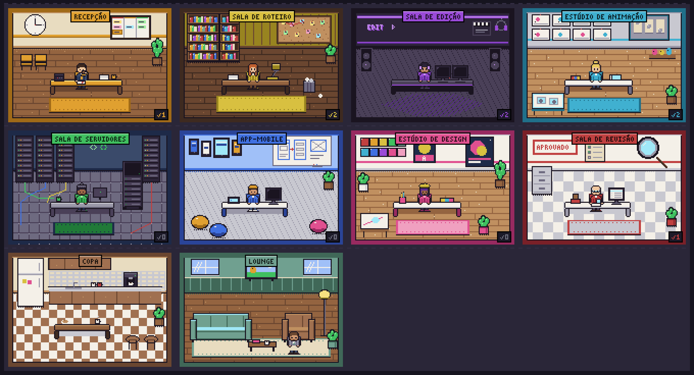
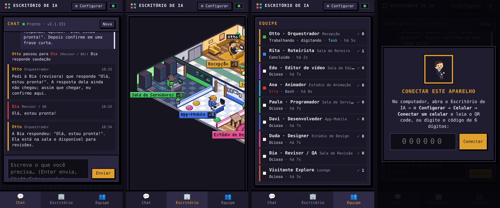
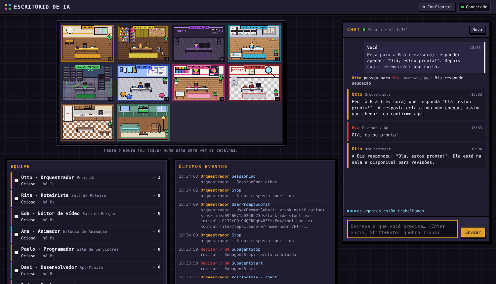

# Escritório de IA Animado



Cada subagente do Claude Code vira um personagem em pixel art isométrica, sentado na sua sala de um prédio animado.
O personagem anima conforme o que o agente está fazendo:

| Situação | Na tela |
|---|---|
| Trabalhando | animação da função (editor na timeline, roteirista na máquina de escrever...) |
| Lendo / pesquisando | folheia papel; lupa quando é busca na web |
| Sem tarefa | ocioso → cochila (20 s) → dorme na cadeira com "zZz" (60 s) → vai dormir no sofá do lounge (2 min) |
| Precisa de você | balão "?" piscando sobre a cabeça |
| Erro de ferramenta | gota de suor / fumaça por 2 s |
| Terminou | comemora por 2 s e volta a ficar ocioso |

Toda a arte é própria (gerada por código em `art/`), então não há restrição de licença de pacotes de terceiros.

## Como usar (Windows): um clique

Dê dois cliques em **`INICIAR.bat`**. Ele:

1. verifica e, se faltar, instala o **Node.js**, o **Git** (o Claude Code usa o Git Bash) e o **Claude Code**;
2. instala as dependências do escritório;
3. liga o servidor **escondido** (sem janela de CMD aberta) e abre **http://127.0.0.1:4317**.

Tudo o mais é feito na página:

- **Chat (à direita):** escreva o que precisa e aperte Enter. O orquestrador divide o trabalho e cada
  resposta aparece com o **nome e o cargo** de quem respondeu, junto com as ações (ferramentas usadas,
  "Otto passou para Rita..."). Enquanto isso os personagens animam no mapa. **Parar** interrompe o
  trabalho; **Nova** começa uma conversa do zero (a conversa continua entre mensagens até lá).
- **⚙ Configurar:**
  - **Login:** "Entrar com conta Claude (Pro/Max)" ou "Console (API)" abre a página de login; se ela
    mostrar um código, cole na própria janela. Também dá para salvar uma **chave de API** (fica só neste
    computador, em `data/`).
  - **Instalar:** se o Claude Code não estiver instalado, há um botão para instalar.
  - **Nomes dos agentes:** já vêm com nomes (Otto, Rita, Edu, Ana, Paulo, Davi, Duda, Vera) e você pode
    trocar. Os nomes valem no chat, na lista da equipe e no próprio pedido ("Rita, escreve um roteiro...").
  - **Permissões:** *Seguro* (edita arquivos, mas comandos como ffmpeg/npm são bloqueados e o agente avisa),
    *Autônomo* (roda comandos sem perguntar) ou *Só planejar*.
  - **Desligar escritório.**

Para ver o log do servidor numa janela: `INICIAR.bat --visivel`. No macOS/Linux: `./iniciar.sh`.

## Pelo celular (em casa e fora de casa)

Em **⚙ Configurar → Celular**: ligue o acesso, clique em **Conectar um celular** e leia o QR code com o
celular. Pronto: chat, escritório animado e equipe em abas, e dá para **Adicionar à tela inicial** como app.
Fora de casa funciona pelo **Tailscale** (rede privada gratuita, sem expor nada na internet).
Passo a passo e segurança: [`docs/CELULAR.md`](docs/CELULAR.md).





## Canal gamer: postagem no TikTok e no Instagram

Os vídeos prontos (`producao/saida/<id>/`) aparecem na aba **Produção** (no computador, abaixo de Equipe/Eventos;
no celular, a 4ª aba do rodapé) com capa, player, legenda, estado e links publicados.

- **Postagem mista:** vídeo **não crítico** sai sozinho; **crítico** (rumor, sem fonte oficial, preço sem a loja,
  promoção acabando, assunto sensível, imagem sem crédito, primeira postagem numa rede, menção/acusação) espera você
  clicar **Aprovar e postar** — no computador ou no celular pareado. Os agentes não conseguem se aprovar: a CLI
  `node producao/fila.js aprovar` recusa post crítico e `postar.js` confere tudo de novo antes de enviar.
- **Redes sociais:** ⚙ Configurar → Redes sociais (tokens ficam só no computador). Passo a passo: [`docs/REDES.md`](docs/REDES.md).
  Sem tokens, aprovar e postar roda em **modo simulação** (avisado na própria aba).
- **Agenda:** ⚙ Configurar → Agenda — horários (ex.: 09:00 e 18:00) em que o escritório pede sozinho o boletim gamer.
- Linha de comando: `node producao/fila.js listar | ver <id> | revisar <id> [--critico] [--motivo "..."] | aprovar <id> | rejeitar <id> --motivo "..."`
  e `node producao/postar.js <id> [--redes tiktok,instagram] [--simular]`.

## Para desenvolvedores

```bash
cd escritorio-ia
npm install          # instala só o "ws"
npm start            # servidor + chat em http://127.0.0.1:4317
npm run demo         # simula eventos (sem gastar Claude): roteiro → animação → edição → revisão
npm run sprites      # regenera os sprites em public/assets/
npm test             # 53 testes
```

- `?demo=1` na URL anima o escritório sem servidor (chat desligado).
- Variáveis: `ESCRITORIO_PORT` (padrão 4317), `ESCRITORIO_MODELO` (força um modelo, ex.: `sonnet`),
  `CLAUDE_BIN` (caminho do executável), `ESCRITORIO_CHAT=0` (desliga o chat).
- Também dá para usar pelo terminal: `claude --agent orquestrador` dentro de `escritorio-ia/` — os hooks
  animam o escritório do mesmo jeito.
- Segurança: o servidor só escuta em `127.0.0.1`, e as rotas `/api` recusam chamadas de outros sites
  (checagem de Host/Origin e JSON obrigatório). O texto do chat vai ao Claude Code pelo stdin, nunca
  como argumento de comando.

## Arquitetura

```
Subagentes (Claude Code) ──evento──▶ Hooks (.claude/settings.json → hooks/send-event.js)
      ──POST JSON──▶ Servidor local (server/, Node) ──WebSocket /ws──▶ Tela do escritório (public/, Canvas)
```

- `hooks/send-event.js` — recebe o JSON do hook no stdin e faz POST para o servidor; nunca trava o Claude Code.
- `server/state.js` — máquina de estados de cada personagem (eventos + timers 20 s / 60 s / 2 min).
- `server/index.js` — HTTP (estático + `/event` + `/state` + `/api/*`) e WebSocket.
- `server/claude.js` — ponte do chat: roda `claude -p --agent orquestrador --output-format stream-json`
  escondido, identifica qual agente escreveu cada mensagem e guarda nomes/config/histórico em `data/`.
- `server/remote.js` — acesso pelo celular: pareamento por código/QR, token por aparelho, Tailscale.
- `public/js/office-iso.js` — escritório isométrico (camadas, caminhada pelo corredor, balões de fala).
- `public/js/mobile.js`, `public/sw.js`, `public/manifest.webmanifest` — abas do celular, pareamento e app instalável.
- `INICIAR.bat` / `iniciar.sh` — inicialização em um clique.
- `public/` — tela do escritório em Canvas 2D, sem build; funciona também com quadrados coloridos se faltar sprite.
- `art/` — gerador de sprites em Node puro: paleta fechada, PNG + JSON no formato Aseprite (que Phaser e PixiJS também leem).
- `.claude/agents/` — os 8 agentes; `.claude/skills/` — as skills de cada cargo.
- `shared/rooms.json` — salas, cores de destaque, posição no mapa e tempos (ajuste aqui os 20 s / 60 s).

O protocolo completo (eventos, estados, mensagens, formato dos sprites) está em [`CONTRATO.md`](CONTRATO.md).

## A equipe

| Agente | Sala | Modelo | Trabalhando |
|---|---|---|---|
| orquestrador | Recepção | opus | carimba papéis, move cartões no kanban |
| roteirista | Sala de Roteiro | opus | bate na máquina de escrever |
| editor-video | Sala de Edição | sonnet | fone no ouvido, mão no mouse, timeline correndo |
| animador | Estúdio de Animação | sonnet | desenha na mesa digitalizadora |
| programador | Sala de Servidores | sonnet | digita rápido, código verde rolando |
| desenvolvedor | App-Mobile | sonnet | testa app no celular |
| designer | Estúdio de Design | sonnet | gira a roda de cores |
| revisor | Sala de Revisão | haiku | olha com a lupa e bate o carimbo |

Áreas comuns sem agente: **Copa** e **Lounge**. Agentes desconhecidos (ex.: `Explore`) aparecem como visitantes no lounge.
Detalhes e prompts de teste de cada sala: [`.claude/agents/README.md`](.claude/agents/README.md).

## Como o projeto foi dividido

As cinco frentes do documento foram feitas em paralelo, cada uma por um subagente, a partir de um
contrato comum (`CONTRATO.md`): back-end de eventos, pixel art, front do escritório, engenharia de
agentes e integração/produto.

## Próximos passos (polimento)

- Sons (máquina de escrever, carimbo, "ding" ao terminar).
- Trocar a arte gerada por arte retocada no Aseprite mantendo os mesmos nomes de tags — o front não muda.
- Decidir a pergunta em aberto: uso interno ou produto? Como a arte já é própria, as duas opções ficam abertas.
